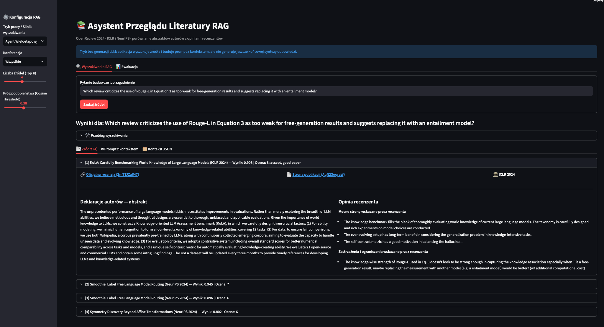

# Asystent przeglądu literatury RAG — OpenReview 2024

Aplikacja do przeszukiwania publikacji naukowych i oficjalnych recenzji z konferencji **ICLR 2024** oraz **NeurIPS 2024**. Łączy abstrakty autorów z ocenami recenzentów, prezentuje źródła i umożliwia porównanie metod wyszukiwania w interfejsie Streamlit.

> **Zakres:** jest to system retrieval i przygotowywania kontekstu dla RAG, **bez podłączonego generatywnego LLM**. Agent jest deterministycznym kontrolerem narzędzi wyszukiwawczych, a nie autonomicznym modelem językowym. Wyniki ewaluacji dotyczą odnajdywania źródeł, nie jakości wygenerowanych odpowiedzi.

## Podgląd aplikacji



*Przykład wyszukiwania recenzji publikacji KoLA. Interfejs pokazuje źródła, deklaracje autorów i uwagi recenzenta.*
  
## Dane

- **80 publikacji**: po 40 z ICLR 2024 i NeurIPS 2024.
- **308 oficjalnych recenzji** powiązanych z publikacjami.
- Dane: `data/papers.json`, `data/reviews.json`; metadane doboru próby: `data/sampling_metadata.json`.
- Źródło: OpenReview API v2. Uwzględniane są oficjalne recenzje, a nie komentarze, decyzje i odpowiedzi autorów.

## Metody wyszukiwania

1. **Wektorowe:** podobieństwo semantyczne, lokalny indeks ChromaDB.
2. **BM25:** dopasowanie leksykalne do tekstu abstraktów i recenzji.
3. **Hybrydowe RRF:** łączenie rankingów wektorowego i BM25.
4. **Agent deterministyczny:** maksymalnie trzy kroki narzędziowe; rozpoczyna od wyszukiwania wektorowego, w razie potrzeby przeformułowuje zapytanie i uruchamia hybrydę, stosuje dodatkowe uporządkowanie według terminów technicznych i może pobrać uzupełniający kontekst. Kontekst dodatkowy nie jest traktowany jako wynik rankingu.
5. **Tylko abstrakty:** wariant ablacyjny bez treści recenzji.

Aplikacja pokazuje tytuły prac, identyfikatory i odnośniki OpenReview, fragmenty abstraktów i ocen recenzentów, przebieg narzędzi agenta oraz kontekst do ewentualnej generacji odpowiedzi.


## Instalacja i uruchomienie

**Wymagania:** Python 3.12 (zalecany), Git i dostęp do internetu przy pierwszym uruchomieniu. Projekt uruchamia się z terminala w VS Code, PyCharmie lub systemowego.

### 1. Pobranie projektu

```bash
git clone https://github.com/maciejonisiewicz/solvro-rag-rekrutacja.git
cd solvro-rag-rekrutacja
```

### 2. Instalacja zależności

**Windows (PowerShell):**

```powershell
py -3.12 -m venv .venv
.\.venv\Scripts\python.exe -m pip install -r requirements.txt
```

**macOS / Linux:**

```bash
python3 -m venv .venv
source .venv/bin/activate
python -m pip install -r requirements.txt
```

### 3. Uruchomienie aplikacji

**Windows:**

```powershell
.\.venv\Scripts\python.exe -m streamlit run app.py --server.fileWatcherType none
```

**macOS / Linux:**

```bash
python -m streamlit run app.py --server.fileWatcherType none
```

Otwórz `http://localhost:8501`. Indeks ChromaDB zostanie utworzony automatycznie z danych w repozytorium.

### 4. Ewaluacja

Zatrzymaj aplikację (`Ctrl+C`), a następnie uruchom:

**Windows:**

```powershell
.\.venv\Scripts\python.exe evaluate.py
```

**macOS / Linux:**

```bash
python evaluate.py
```

**Sprawdzone konfiguracje:** Windows — Python 3.12 i 3.14; macOS — Python 3.14. Python 3.15 na Windowsie nie przeszedł instalacji zależności.


## Metodologia ewaluacji

Zbiór zawiera **12 pytań**: 10 z odpowiedzią w danych i 2 bez wystarczających danych. Metryki **Paper Hit@5** są liczone na 10 pytaniach z odpowiedzią. Metryki **Review Hit@5**, **MRR@5** i **nDCG@5** są liczone wyłącznie na **8 pytaniach z ręcznie oznaczoną docelową recenzją**. Dla wariantu tylko z abstraktami metryki recenzji nie mają zastosowania (N/A).

### Wyniki lokalnej ewaluacji

| Metoda | Paper Hit@5 | Review Hit@5 | MRR@5 | nDCG@5 |
|---|---:|---:|---:|---:|
| Wektorowe (ChromaDB) | 100% | 87,5% | 0.542 | 0.615 |
| BM25 (abstrakty + recenzje) | 100% | 100% | 0.917 | **0.930** |
| Hybrydowe (RRF) | 100% | 100% | 0.906 | 0.870 |
| Agent deterministyczny | 100% | 100% | **1.000** | 0.903 |
| Tylko abstrakty | 90% | N/A | N/A | N/A |

**Interpretacja:** agent osiąga najwyższe MRR@5, natomiast BM25 osiąga najwyższe nDCG@5. Samo dodanie hybrydy nie poprawia każdej metryki względem BM25.

### Analiza błędu: Q04

Pytanie dotyczy krytyki **ROUGE-L w Equation 3** i propozycji użycia modelu entailment. Prawidłowa recenzja: `2mTTJZa647` dla publikacji `AqN23oqraW` (*KoLA: Carefully Benchmarking World Knowledge of Large Language Models*).

- Wektorowe: pozycja **7**.
- BM25: pozycja **1**.
- Hybrydowe: pozycja **1**.
- Agent po poprawkach: pozycja **1**.

Ten przykład pokazuje ograniczenie dopasowania semantycznego dla rzadkich, dokładnych terminów technicznych. Nie dowodzi jednak przewagi jednej metody dla dowolnych zapytań.

### Pytania bez danych

Przy progu podobieństwa **0.38** oba pytania zostały prawidłowo odrzucone: Q11 (wynik 0.292) i Q12 (0.168). Lokalna skuteczność odrzucenia: **2/2**.


## Struktura projektu

```text
solvro-rag-rekrutacja/
├── app.py                 # Interfejs Streamlit
├── agent_rag.py           # Agent deterministyczny i kontekst źródłowy
├── rag_system.py          # ChromaDB, BM25 i wyszukiwanie hybrydowe
├── evaluate.py            # Ewaluacja i analiza błędów
├── fetch_data.py          # Pobieranie danych z OpenReview
├── requirements.txt       # Zależności Pythona
├── README.md              # Dokumentacja projektu
└── data/
    ├── papers.json
    ├── reviews.json
    ├── sampling_metadata.json
    ├── eval_questions.json
    └── eval_results.json
```

Indeks ChromaDB jest generowany lokalnie przy pierwszym uruchomieniu. Pliki indeksu i logi działania nie są przechowywane w repozytorium.
  

## Ograniczenia i możliwe rozwinięcia

- Niewielki zbiór ewaluacyjny (8 pytań z docelową recenzją) ogranicza możliwość uogólniania wyników.
- Dodatkowe sortowanie agenta na podstawie terminów technicznych jest heurystyką, a nie trenowanym rerankerem; wymaga testów na większym zbiorze.
- Próg odrzucenia 0.38 zweryfikowano lokalnie tylko na dwóch pytaniach bez odpowiedzi.
- Metryki retrieval nie oceniają prawdziwości ani jakości końcowej odpowiedzi LLM, ponieważ model generatywny nie jest podłączony.
- Możliwe rozwinięcia: większy zbiór ground truth, niezależny zbiór testowy, analiza czasu odpowiedzi i kosztu, reranker cross-encoder oraz generacja odpowiedzi z cytowaniami.

## Powtarzalność

Wyniki podane wyżej pochodzą z lokalnego raportu `data/eval_results.json` po poprawkach rankingu agenta. Przed porównywaniem kolejnych zmian należy zachować wersję danych, konfigurację indeksu, próg odrzucenia i ten sam zestaw pytań.
